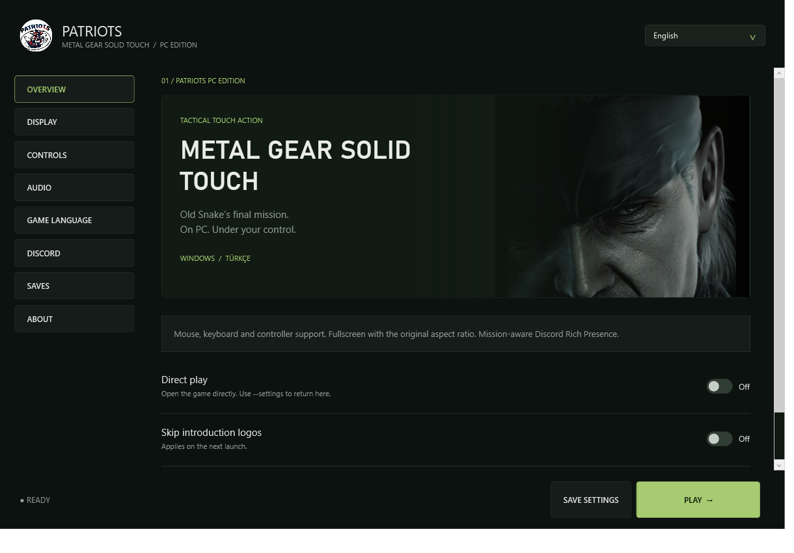
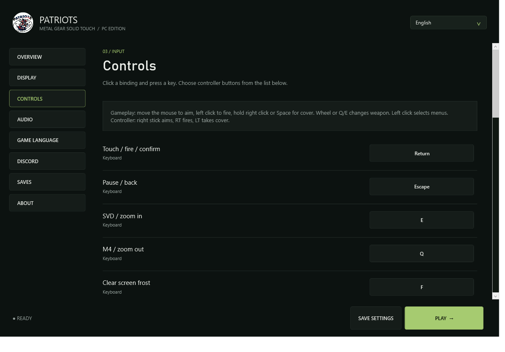
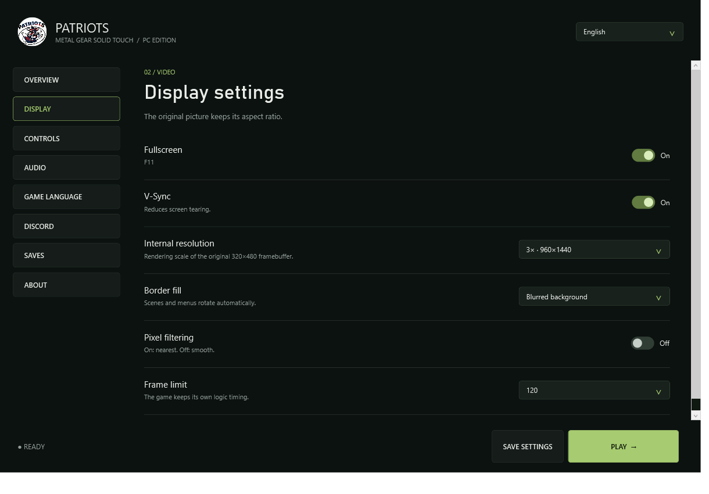
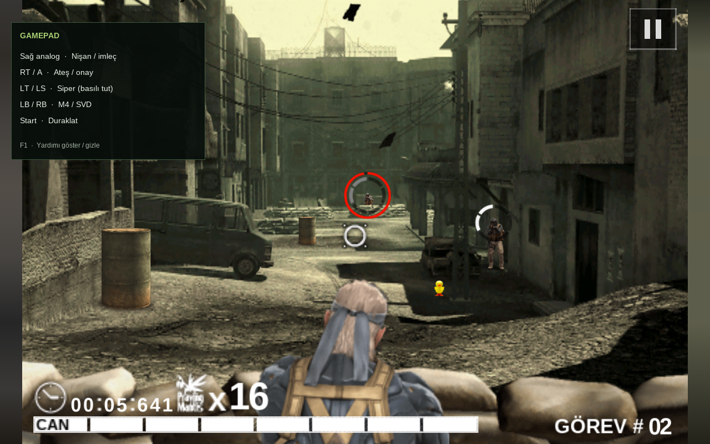
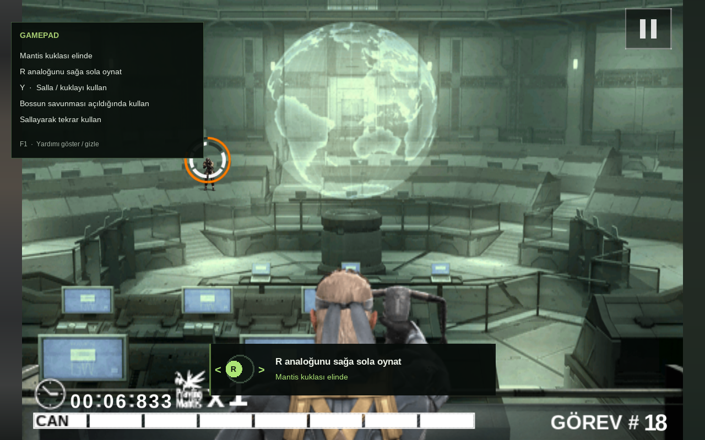
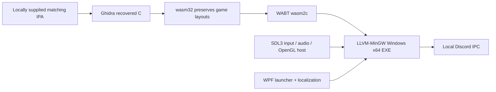

# Metal Gear Solid Touch · Patriots PC

A Windows x64 AOT port of the **iOS version**, with a multilingual launcher, mouse / keyboard / controller support and Discord Rich Presence.

**[Türkçe](README.tr.md) · [Download](https://github.com/TheAti1/metal-gear-solid-touch-patriots/releases/latest) · [Controls](docs/CONTROLS.md) · [Build](docs/BUILD.md) · [Changelog](CHANGELOG.md) · [Translate](docs/TRANSLATING.md)**

## Android

**[Download Android APK](https://github.com/TheAti1/metal-gear-solid-touch-patriots/releases/tag/android-v1.0.1) · [Android build / update guide](android-patriots/README.md)**

Android 9+, ARM64 / ARMv7 / x86_64; bundled game data, Turkish / English launcher and game, startup update checks and verified signed APK updates. Android releases use a separate channel from PC.

## Play

1. Download **MGS_Touch_Patriots_PC_v1.1.0.zip** from [Releases](https://github.com/TheAti1/metal-gear-solid-touch-patriots/releases/latest).
2. Extract the whole archive to a writable folder. Keep its folders together.
3. Open **Metal Gear Solid Touch.exe**, select your language and settings, then click **PLAY / OYNA**.

No iPhone, iOS emulator, Python, Ghidra or compiler is required to play the prepared Windows package. The game needs Windows x64, .NET Framework 4.x for the launcher and a working OpenGL driver. SDL3 is included. The local test system was Windows 10 Pro with Intel HD Graphics 620; this is not a performance guarantee for every PC.

Existing players can use **MGS_Touch_Patriots_PC_v1.1.0_Guncelleme.zip** over their existing installation. Back up `Saves/` first. The update contains no personal save or settings files. A full download starts with clean saves and cheats disabled.

## Features

| Area | Included |
|---|---|
| Languages | English / Turkish launcher and game, plus imported community JSONs; launcher/game chosen independently |
| Launcher | Display, audio, input mapping, language import, save backups and Discord settings |
| Desktop input | Relative mouse aiming, configurable keyboard and SDL gamepads |
| Menus | Semantic selection, confirm/back, hover colors, pause/resume and retry |
| Long text | Right-stick, mouse-wheel and Page Up / Page Down scrolling |
| Presentation | Fullscreen, 1×–4× render scale, filtering and aspect-ratio-preserving borders |
| Discord | Current mission / phase, pause state and elapsed session time |
| Localization | Turkish glyph coverage, translated runtime strings and REX JSON workflow |

The launcher hides while the game is running and returns when it closes. Opening the launcher again focuses the running game. In-game Patriots buttons open the Patriots website.

The original game uses 2D backgrounds and a fixed presentation. Border fills preserve the intended proportions; **this release does not add genuine 16:9 world geometry**.

## Help translate

Send the contributor just **[the 161-entry launcher JSON](localization/launcher/pt-BR.launcher.json)** and **[the 549-entry game JSON](localization/game/pt-BR.game.json)**. Edit only `text` and preserve tokens. Import each file from **LANGUAGES**, or ZIP `launcher.json` and `game.json` at the root. [Full guide](docs/TRANSLATING.md). Brazilian Portuguese files are blank templates; official support follows review of the actual completed translation.

## Default controls

| Action | Keyboard / mouse | Controller |
|---|---|---|
| Aim | Mouse, WASD / arrows | Right stick |
| Fire / confirm | Left click / Enter | RT / south face button |
| Cover | Right click / hold Space | LT / configured cover button |
| M4 / SVD | Wheel / Q / E | LB / RB |
| Pause / back | Escape | Start / east face button |
| Menu selection | WASD / arrows | Left stick / D-pad |
| Scroll text | Wheel / Page Up / Page Down | Right stick up / down |
| Controls help | F1 | F1 on keyboard |
| Fullscreen / screenshot | F11 / F12 | — |

Controller labels follow Xbox, PlayStation or Nintendo layouts and configured mappings. See [the complete control guide](docs/CONTROLS.md), including boss-specific gestures:

- **Mission 18:** with the Mantis doll equipped, wiggle the right stick left and right. An animated R-stick prompt appears. Keyboard users use the configured shake key, default **F**.
- **Mission 20 only:** push the right stick left or right to dodge in that screen direction. Centre it before the next dodge. A held stick does not repeat the move or trigger it after loading / resume.

## Screenshots

| Controls | Display |
|---|---|
|  |  |

| Gameplay | Mantis doll gesture |
|---|---|
|  |  |

## How this port works

This is based on **Metal Gear Solid Touch 2.3.0 for iOS / ARMv6**, not MGS Mobile, J2ME or Symbian. It uses the decompilation and runtime foundation by **[etruj](https://github.com/etruj)**.

The wasm32 stage is an **intermediate build representation**. The Windows release runs compiled x64 code; it does not interpret the original ARM instruction stream at runtime. It still depends on compatibility implementations of the original platform APIs and locally recovered game code. It is a decompilation-based AOT port, not a clean-room rewrite of every part of the engine.

The Git tree contains the modified runtime, decompiler tooling, Windows integration, launcher, translations, documentation and screenshots. It contains **no IPA, original Mach-O game executable, generated original game C, personal save or credentials**. The prepared playable release contains the game assets it needs; those assets are separate from the source tree and retain their original ownership.

## Build and validation

- [Build guide](docs/BUILD.md): pinned upstream revisions, toolchain layout, native pipeline and launcher-only build.
- [Architecture](docs/ARCHITECTURE.md): recovered game logic, desktop input, localization and Discord.
- [Validation](docs/VALIDATION.md): checks actually performed and remaining limits.
- [Troubleshooting](docs/TROUBLESHOOTING.md): saves, cheats, input, fullscreen and updates.

GitHub Actions checks the source boundaries, frozen translation metadata and standalone WPF launcher. It **does not rebuild or test the complete game without the original matching input**. Historical gameplay reports include the executable hashes they tested; they are not relabelled as fresh tests of every later build. The entire 20-mission game was not played through as one complete regression run.

## Credits

Original game: **Konami / Kojima Productions**. Decompilation and platform foundation: **[etruj/MetalGearSolidTouch-Decompilation-](https://github.com/etruj/MetalGearSolidTouch-Decompilation-)** and **[etruj/mgs-retouched](https://github.com/etruj/mgs-retouched)**. Windows integration and Turkish localization: **[Patriots Çeviri](https://www.patriotsceviri.com.tr/)**.

See [NOTICE.md](NOTICE.md), [LICENSE](LICENSE) and [component licenses](licenses/). This is an independent fan project, not an official Konami release.
