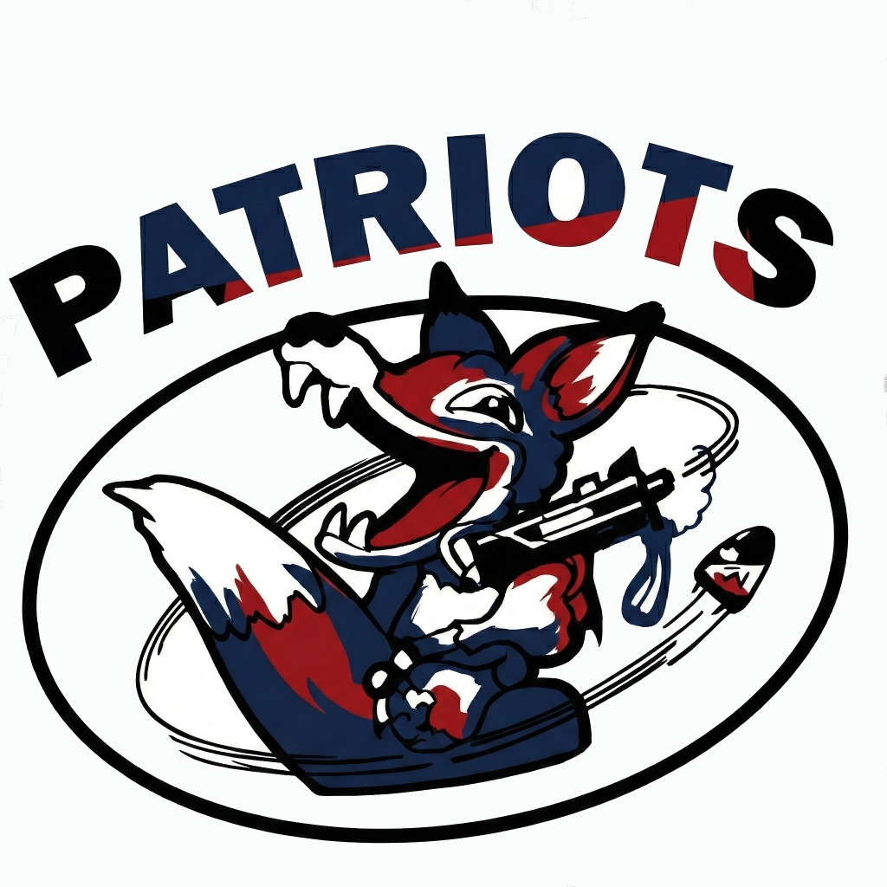
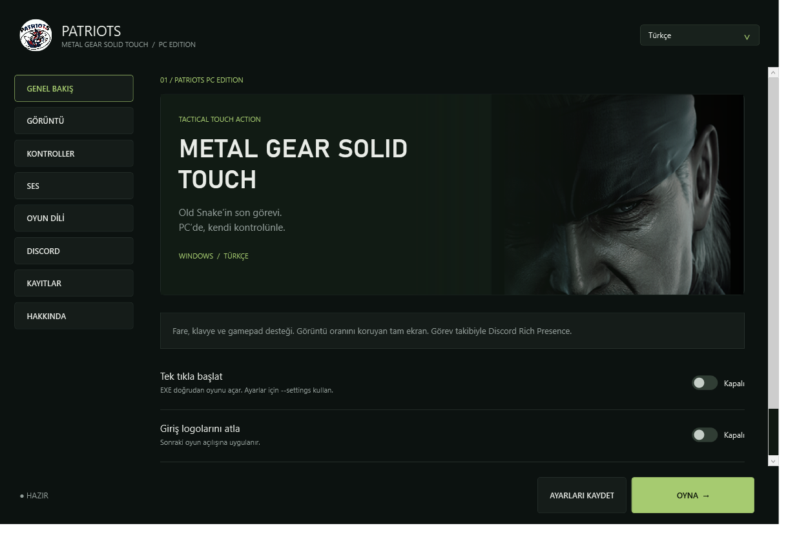

# Metal Gear Solid Touch · Patriots PC

<a href="https://recomplauncher.com"><picture><source media="(prefers-color-scheme: dark)" srcset="https://recomplauncher.com/assets/press/launcher/badge-light.svg"></picture></a>

**iOS sürümünden türetilmiş Windows x64 AOT portu.** Türkçe / İngilizce / Brezilya Portekizcesi launcher ve oyun, fare / klavye / gamepad desteği ve Discord Rich Presence.

**[English](README.md) · [İndir](https://github.com/TheAti1/metal-gear-solid-touch-patriots/releases/latest) · [Kontroller](docs/CONTROLS.md) · [Derleme](docs/BUILD.md) · [Sürüm notları](CHANGELOG.md)**

## Android

**[Download Android APK](https://github.com/TheAti1/metal-gear-solid-touch-patriots/releases/tag/android-v1.1.1) · [Android build / update guide](android-patriots/README.md)**

Android 9+, ARM64 / ARMv7 / x86_64; oyun dosyaları APK içinde, Türkçe / İngilizce / Brezilya Portekizcesi seçimi ve açılışta güncelleme kontrolü. Android sürümleri PC sürümlerinden ayrı bir kanalda yayımlanır.

Android başlatıcısı PC tasarımıyla yenilendi: aynı görseller ve renkler, sabit OYNA düğmesi, telefon/tablete uyarlanan sekmeler. [Görseller ve kontroller](docs/ANDROID-LAYOUT.md).

Android 1.1.1, oyun içinde ekran dönüşünden sonra kalan kırpılma/kayma sorununu; duraklatma görüntüsü ve dokunma durumuyla birlikte düzeltir. [Ayrıntılar ve dönüş testleri](docs/ANDROID-ROTATION.md).

## Kurulum

1. [Releases](https://github.com/TheAti1/metal-gear-solid-touch-patriots/releases/latest) bölümünden **MGS_Touch_Patriots_PC_v1.2.1.zip** dosyasını indir.
2. Arşivi yazılabilir bir klasöre tamamen çıkart. EXE ile yanındaki klasörler birlikte kalmalı.
3. **Metal Gear Solid Touch.exe** dosyasını aç, dil ve ayarlarını seç, **OYNA** düğmesine bas.

Hazır paketi oynamak için iPhone, iOS emülatörü, Python veya derleyici gerekmez. Launcher .NET Framework 4.x, oyun Windows x64 ve çalışan bir OpenGL sürücüsü kullanır. SDL3 pakettedir. Yerel denemeler Windows 10 Pro / Intel HD Graphics 620 üzerinde yapıldı; bütün bilgisayarlar için performans garantisi değildir.

Mevcut kurulum için **MGS_Touch_Patriots_PC_v1.2.1_Guncelleme.zip** kullanılabilir. Önce `Saves/` klasörünü yedekle, sonra güncelleme dosyalarını mevcut oyun klasörünün üzerine çıkart. Güncelleme kişisel kayıt veya ayar dosyası içermez. Tam paket temiz kayıt klasörüyle ve hileler kapalı gelir.

## Neler var?

- Launcher dili ve oyun dili için bağımsız **Türkçe / English** seçimi.
- Görüntü, ses, kontrolcü / klavye eşleme, çeviri içe aktarma, kayıt yedekleme ve Discord sayfaları.
- Fareyle nişan, klavye desteği, SDL gamepad algılama ve kullanılan aygıta göre değişen tuş yardımı.
- Menü seçimi, doğru onay / geri davranışı, fare üzerine gelince renk değiştirme, duraklatma ve yeniden deneme.
- Uzun metinleri sağ analog, fare tekerleği ve Page Up / Page Down ile kaydırma.
- Tam ekran, 1×–4× çizim ölçeği, filtre ve görüntü oranını koruyan kenar seçenekleri.
- Discord masaüstü uygulamasında görev, durum, duraklama ve oturum süresi.
- Türkçe karakterleri destekleyen fontlar, çevrilmiş runtime yazıları ve REX JSON iş akışı.

Oyun açılınca launcher gizlenir, oyun kapanınca geri gelir. Launcher EXE'sini yeniden açmak çalışan oyuna döner. Oyun içindeki Patriots düğmeleri siteyi açar.

Özgün 2B arka planların oranı korunur; kenar doldurma seçenekleri **gerçek 16:9 sahne genişletmesi değildir**.

## Kontroller

| İşlem | Klavye / fare | Gamepad |
|---|---|---|
| Nişan | Fare, WASD / yön tuşları | Sağ analog |
| Ateş / onay | Sol tık / Enter | RT / alt yüz düğmesi |
| Siper | Sağ tık / Space basılı | LT / atanmış siper düğmesi |
| M4 / SVD | Tekerlek / Q / E | LB / RB |
| Duraklat / geri | Escape | Start / sağ yüz düğmesi |
| Menü seçimi | WASD / yön tuşları | Sol analog / D-pad |
| Metin kaydırma | Tekerlek / Page Up / Page Down | Sağ analog yukarı / aşağı |
| Tuş yardımı | F1 | Klavyeden F1 |
| Tam ekran / ekran görüntüsü | F11 / F12 | — |

Eşlemeler launcher'dan değişir. Xbox / PlayStation / Nintendo düğme adları aygıta göre gösterilir.

**18. görev:** Mantis kuklası elindeyken sağ analoğu sağa sola salla. Ekranda hareketli R analoğu uyarısı çıkar. Klavyede atanmış sallama tuşunu kullan; varsayılan **F**. Ateş tuşu kuklayı sallamaz.

**20. görev / son boss:** sağ analoğu sağa veya sola iterek o yöne kaçın. Yeni kaçınma için analoğu ortala. Basılı tutmak tekrar etmez; yükleme ve duraklatmadan sonra da önce ortalamak gerekir. Bu kaçınma eşlemesi diğer görevlerde çalışmaz.

[Ayrıntılı kontrol belgesi](docs/CONTROLS.md).

## Son düzeltmeler

| Sürüm | Değişiklik |
|---|---|
| 1.0.8 | Oyun sonundaki Hayatta Kalma tavsiyesi yatay açılır; İleri onayı çalışır |
| 1.0.7 | Son boss kaçınmasının ters sağ / sol yönleri düzeltildi |
| 1.0.6 | Yalnızca son boss için sağ analogla kaçınma eklendi |
| 1.0.5 | Mantis kuklası için animasyonlu uyarı / sallama, ölümden sonra yeniden deneme ve tavsiye onayı |
| 1.0.4 | Menü hover renkleri, Özel / geçmiş yönü ve metin kaydırma |

## Bu recomp mu, decomp mu?

Temel alınan oyun **Metal Gear Solid Touch 2.3.0'ın iOS / ARMv6 sürümü**. MGS Mobile, J2ME veya Symbian değildir. [etruj](https://github.com/etruj) tarafından geliştirilen decompiler ve runtime temelinden yararlanır.

Akış: yereldeki eşleşen IPA → Ghidra ile çıkarılan C → özgün 32 bit bellek düzenini koruyan wasm32 → WABT wasm2c → LLVM-MinGW ile Windows x64 EXE.

WebAssembly burada derleme ara biçimidir. Oyun çalışırken ARM komutları tek tek emüle edilmez; derlenmiş x64 kod çalışır. Platform uyumluluk katmanları ve yerelde çıkarılan oyun kodu kullanılır. Bu yüzden **decompilation tabanlı AOT portu** demek uygundur; motorun tamamının sıfırdan yazıldığı iddia edilmez.

Git ağacında değiştirilmiş runtime, decompiler araçları, Windows entegrasyonu, launcher, çeviriler, belgeler ve ekran görüntüleri vardır. **IPA, özgün Mach-O oyun EXE'si, üretilmiş özgün oyun C dosyaları, kişisel kayıtlar ve kimlik bilgileri yoktur.** Hazır oynanabilir Releases paketi gerekli oyun varlıklarını içerir; bu varlıklar kaynak depodan ayrıdır ve hakları sahiplerinde kalır.

## Geliştirme ve doğrulama

[Derleme](docs/BUILD.md) · [Mimari](docs/ARCHITECTURE.md) · [Test kapsamı](docs/VALIDATION.md) · [Sorun giderme](docs/TROUBLESHOOTING.md)

GitHub Actions kaynak sınırlarını, çeviri metadatasını ve WPF launcher derlemesini kontrol eder. Eşleşen özgün girdi olmadan tüm oyunu derlemez / test etmez. Eski oynanış raporları denedikleri EXE'nin hash'ini korur; bütün sonraki sürümlerin testi gibi sunulmaz. Yirmi görevin tamamı tek bir uçtan uca regresyon turuyla oynanmış değildir.

## Katkılar ve lisans

Özgün oyun: **Konami / Kojima Productions**. Decompilation ve platform temeli: **[etruj/MetalGearSolidTouch-Decompilation-](https://github.com/etruj/MetalGearSolidTouch-Decompilation-)** ve **[etruj/mgs-retouched](https://github.com/etruj/mgs-retouched)**. Windows entegrasyonu ve Türkçe çeviri: **[Patriots Çeviri](https://www.patriotsceviri.com.tr/)**.

[NOTICE.md](NOTICE.md), [LICENSE](LICENSE) ve [bileşen lisansları](licenses/). Bağımsız bir hayran projesidir; resmî Konami sürümü değildir.

## Yeni dil ekleme

Çevirmene [161 metinlik launcher JSON’unu](localization/launcher/pt-BR.launcher.json) ve [549 metinlik oyun JSON’unu](localization/game/pt-BR.game.json) gönder. Yalnızca `text` alanları çevrilir; kimlikler ve işaretler korunur. DİLLER sekmesinden iki dosya ayrı ayrı veya birlikte ZIP olarak kurulabilir. [Çeviri rehberi](docs/TRANSLATING.tr.md). Portekizce şablon boştur; tamamlanan çeviri incelendikten sonra resmî dil olarak eklenecek.
