# How MGS Touch was decompiled: notes from the work

These notes explain **how** the decompilation of *METAL GEAR SOLID TOUCH* v2.3.0 (iOS, 2009) was
done:
- the architecture: static and dynamic analysis run **in parallel**, feeding each other;
- the tools, and why each exists;
- how every function was checked against the original machine code, and how the checker itself
  was checked;
- what went wrong along the way.

They were written by Claude (the AI assistant that did the engineering, with the project owner
directing scope and approving each step) from the project's change journal, scripts and results.
All figures are generated from the project's own data by `tools/make_claude_notes.py`.

**Result at a glance**

| | |
|---|---|
| functions in the binary | **1,395** (1,388 from the compiler's STABS debug list + 7 compiler/linker glue) |
| decompiled to C that compiles standalone | **1,395 (100 %)** |
| machine instructions taken into the decompilation | **all real code** (130,359 of 131,539 in `__text`; the rest is data: literal pools, switch tables, padding) |
| **proven bit-identical to the original by differential testing** | **1,389 (99.6 %)** |
| covered by a written assembly audit instead (crt0, `_main`, dyld glue, switch helpers) | 6 more, so 100 % covered |
| reproducible from scratch | yes: 1,390 functions compile to identical machine code, the other 5 are proven identical |
| independent confirmation | a separate Android port built from this C runs the original game; the 2 defects it found are fixed |

---

## Contents

1. [The target](#1-the-target)
2. [The architecture: static and dynamic, in parallel](#2-the-architecture-static-and-dynamic-in-parallel)
3. [Track 1: static analysis](#3-track-1-static-analysis)
4. [Track 2: dynamic analysis (the oracle)](#4-track-2-dynamic-analysis-the-oracle)
5. [Where the tracks meet: differential testing](#5-where-the-tracks-meet-differential-testing)
6. [Results, figures and maps](#6-results-figures-and-maps)
7. [Checking the checker](#7-checking-the-checker)
8. [Every defect class found](#8-every-defect-class-found)
9. [Timeline](#9-timeline)
10. [Lessons](#10-lessons)
11. [Limits and what is next](#11-limits-and-what-is-next)
12. [Where things are](#12-where-things-are)

---

## 1. The target

`MGSTUS` is a 32-bit ARM (armv6) Mach-O executable from 2010, about 790 KB. Two properties made a
complete decompilation realistic:
- **No FairPlay encryption** (`LC_ENCRYPTION_INFO cryptid=0`), so the code is readable as shipped.
- **Shipped unstripped:** 6,973 STABS debug records name all 1,388 functions with their source
  file. That gives the original build tree: 67 source files, from `MGSTAppDelegate.mm` (the whole
  menu, scene and UI layer, 161 functions) to the 13 enemy classes and a C++ sound library.

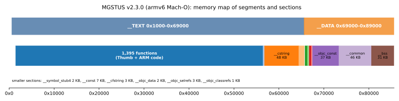

*The executable's segments and sections. `__text` holds all 1,395 functions: 1,388 Thumb, 7 ARM.
`__DATA` holds the Objective-C metadata (classes, selectors, method lists) and the game's
globals.*

---

## 2. The architecture: static and dynamic, in parallel

Neither approach alone can produce a *verified* decompilation:

| | static analysis (Ghidra + scripts) | dynamic analysis (the original running in an emulator) |
|---|---|---|
| sees | **all** code | only code that **runs** |
| certainty | a model: types, calling conventions and switch tables are inferences | ground truth: what the machine actually did |
| produces | the C | facts the static side cannot infer, plus states to test the C against |

So the project ran both tracks at the same time and connected them in two directions:

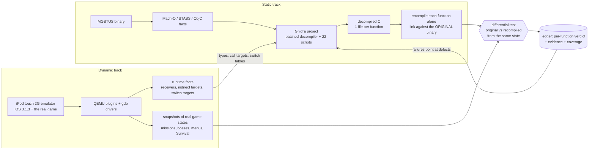

- **Dynamic to static:** runtime facts resolve what static analysis can only guess:
  - which class receives each `objc_msgSend` (needed to type 6,313 call sites);
  - where indirect calls and switch helpers jump;
  - which `bl` instructions never return (they are long branches, not calls).
- **Static to dynamic:** the decompiled C is recompiled and run against the original, starting
  from captured states, and every difference is a defect to fix in the static model.

---

## 3. Track 1: static analysis

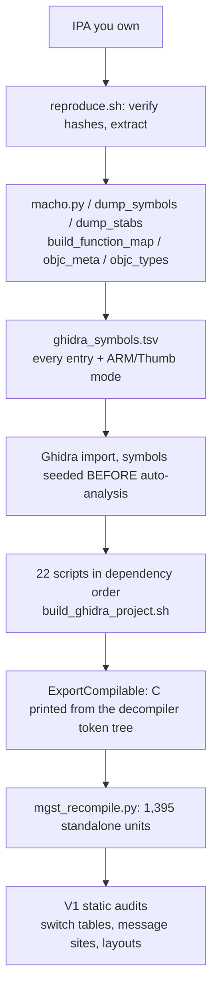

### 3.1 Facts straight from the binary
Pure-Python parsers read the load commands, symbol table and STABS records. The single most
important fact: **each function's ARM/Thumb mode** lives in the symbol's `n_desc`, not in the
address. Seeded into Ghidra before auto-analysis, it prevents Thumb code from being decoded as
ARM. The Objective-C 2.0 metadata (classes, ivars, method lists with type encodings) is read
from `__objc_*` and turned into C structs for every class.

### 3.2 A project-local, patched Ghidra
Ghidra 11.3.2 is copied into the project (`tools/ghidra_overlay.sh`) and its native decompiler
rebuilt with two patches. Both were found by differential testing, because the stock decompiler
printed C whose floating-point results differed from the binary:
- `subflow-exact.patch`: narrowing double arithmetic to float is exact only when at most one
  rounding operation is involved and the constants are exact;
- `printc-float-nonassociative.patch`: float `+` and `*` are not associative, so parentheses
  must be kept.

### 3.3 The Ghidra project: 22 scripts, in order

| stage | scripts | what the decompiler gets |
|---|---|---|
| code structure | InstallSwitchCallFixup, InstallSoftFloatCallFixup, FixSplitsAndStubs, ApplyDynamicCalls, ApplySwitchComments | `bl ___switch8/u8/16` become real `switch` statements (a program-scoped compiler-spec call-fixup, since the public JumpTable API crashed the decompiler); the VFP soft-float helpers become float operators; functions split at Thumb `bl` long branches are re-joined; runtime-observed indirect targets are added |
| types | ApplyObjcTypes, ApplyCppTypes, FixDuplicateTypes, SizeCppClasses, FixCppThis, TypeStaticProcs, ApplyGlobalTypes, ApplyGlobalNames, ApplyExternalPrototypes | every ObjC class from its runtime encoding; C++ sound classes from `this` usage and allocation sizes; globals; iOS SDK prototypes |
| signatures | FixApcsStorage, FixStackStructLocals, CommitInferredSignatures, FixVoidReturns, SetUnusedReturnsVoid, ApplyFloatReturns | Apple's armv6 calling convention (64-bit values 4-byte aligned); `objc_super` and fast-enumeration stack structs; return types proven from call sites; float-bit returns |
| call sites | ApplyCallsiteSignatures, ApplyVarargCallsites, ApplyVarTypes | the **real prototype at each of 6,313 message sends** (selector from p-code or the runtime capture; receiver class from constants, `self` or the runtime); `NSLog`/`printf`/`stringWithFormat:` arguments from the constant format string; individual variables Ghidra merged across int and float |

The order matters. Three ordering bugs were found by rebuilding the project from scratch and
comparing (section 7.2).

### 3.4 Export and recompile
`ExportCompilable.java` prints each function's C from the decompiler's **token tree** rather
than its text. That keeps facts the text loses:
- the exact target of every call (C++ overloads stay distinct);
- a marker at every message-send site, carrying its prototype;
- float/int **bit reinterpretations** as `__BITCAST`, distinct from numeric conversions;
- address-unique names where two Ghidra names would sanitise to the same C identifier.

`mgst_recompile.py` compiles each function **alone** (`clang --target=armv6 -mthumb
-mfloat-abi=softfp`) with a small set of mechanical, logged transforms: stack-frame overlays for
arrays Ghidra split into scalars, bit-level 64-bit pieces, soft-float shims running real VFP
instructions under the device's FPU mode, and integer division with the measured semantics
(x/0 = 0).

---

## 4. Track 2: dynamic analysis (the oracle)

The **oracle** is the original game running on an emulated iPod touch 2nd generation (iOS 3.1.3)
in the community `qemu-ios` fork. Two project patches add TCG plugins:
- **`drcov_mgst`:** coverage plus the dynamic call graph, including the receiver class and
  selector of every `objc_msgSend`;
- **`snap_mgst`:** state capture: per-call entry states, or full-process snapshots between frames.

The game is driven through **gdb** (`tools/mgst_gdb.py`) by writing its own state fields. There
is no bot and no scripted aiming:

| command | effect |
|---|---|
| `mgst-stage N` / `mgst-substage N` | the next `+[Stage setNum:]` / `setSubNum:` gets N: start any mission or boss phase |
| `mgst-godmode`, `mgst-drain`, `mgst-bleed` | the player never dies; enemies lose HP through the game's own death path |
| `mgst-tour` (+ in-screen taps) | switch `GameScene`'s scene the way the title menu does; snapshot each screen |
| `mgst-survival [maxHP]` | play a stage in Survival mode |

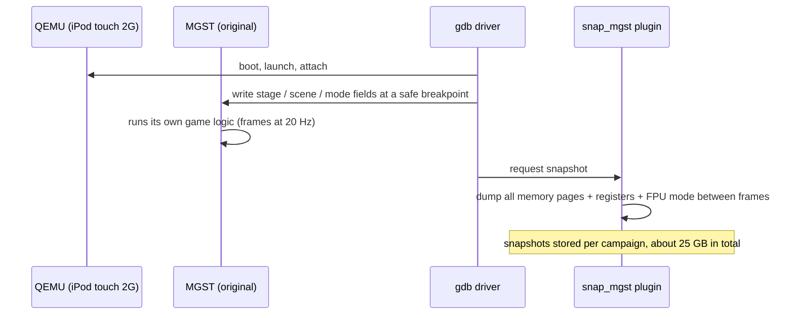

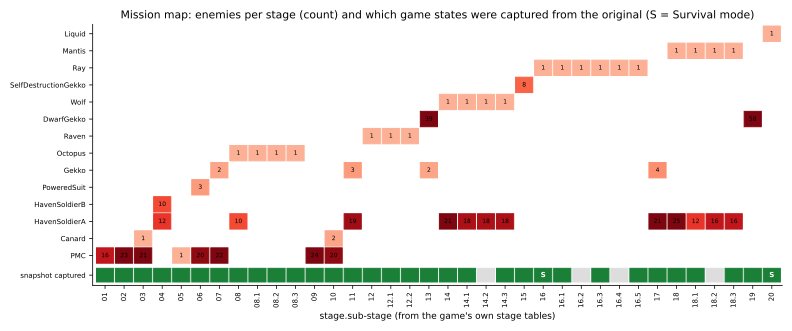

*Every stage and sub-stage from the game's own stage tables, the enemy classes each spawns, and
which states were captured from the running original (green). S marks Survival-mode captures.*

**What the dynamic track fed back to the static one:**
- `msgsend_sites.tsv`: receiver class and selector at each of 4,392 call sites, used to type
  message sends;
- `indirect_targets.tsv`, `switch_targets.tsv`, `bl_nonreturn.tsv`: control flow the static side
  could not resolve;
- `global_names.tsv`: names for globals.

It also produced an important **audit** (2026-09-27). Early runs were on a different game
version (v2.1.0) than the static analysis (v2.3.0): 0 of 2,259 shared functions had the same
address. Every dynamic result was re-done on v2.3.0.

---

## 5. Where the tracks meet: differential testing

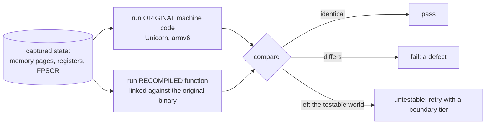

**What is compared:**
- the return registers, as wide as the declared return type;
- **every byte written** outside the run's own stack frame;
- the exact sequence of calls to the outside world with their arguments: OpenGL (including the
  vertex data a draw consumes), OpenAL, libc, framework messages.

Both runs use the device's measured FPU mode (flush-to-zero + default-NaN). Each test runs twice
with different stack poison, so reads of uninitialised memory that the original also performs
are recognised as such, not counted as differences.

**Where the states come from:**
- **natural:** the game called the function in a captured state;
- **frames:** whole frames replayed offline from full-process snapshots;
- **synthetic:** a function the snapshots never reached is called directly, on a live object of
  its class found in the snapshot, with fixed arguments, the object's own field values, or the
  arguments its only caller passes.

**Boundary tiers**, used only when a run leaves the world the snapshot can model:

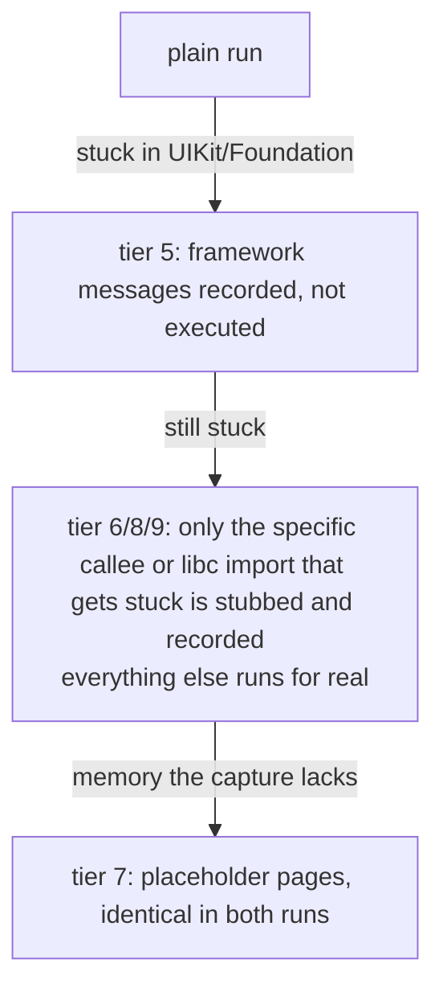

**The ledger and the gate:**
- Every result row carries a fingerprint of the exact binary tested and the harness version, so
  a rebuilt function's old results go stale automatically.
- `mgst_status.py` keeps each function's strongest evidence. A return-value difference counts as
  a failure unless the function is proven `void`.
- **The gate:** every function proven, or covered by a written assembly audit.

---

## 6. Results, figures and maps

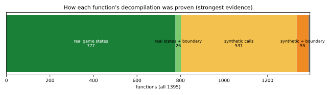

*How each function's decompilation was proven. "Real game states" are calls the original game
made itself; synthetic calls test functions no captured state reached; boundary tiers isolate
calls into code outside the snapshot.*

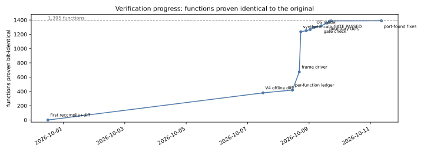

*Functions proven identical over time. The two steepest steps are the frame driver (replaying
whole frames from snapshots) and synthetic calls (functions no snapshot reached).*

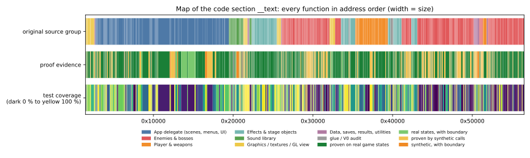

*A map of the code section: every function in address order, by original source group, by
proof evidence, and by how much of it the tests executed.*

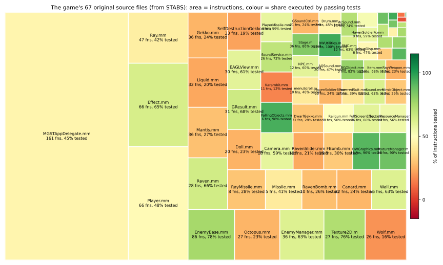

*The 67 original source files, sized by instructions. Colour shows the share of each file's
instructions that passing tests executed.*

---

## 7. Checking the checker

A "100 % proven" claim is only as good as the verification, so the verification was attacked
from several sides.

### 7.1 Is all code decompiled? (`CoverageAudit.java`)
- Ghidra's own function bodies cover only 75.8 % of `__text`, because switch-case code is
  reached through the call-fixups. The audit therefore measures the **decompiler's own flow**
  (`firstpass` p-code) instead.
- Result: 130,359 of 131,539 instructions are taken into functions. The remaining 1,180 are all
  data: literal pools (594), inline switch tables (579) and alignment padding (7). **0
  unexplained.**

### 7.2 Is it reproducible? (`build_ghidra_project.sh`)
- The project database had grown over weeks. It was rebuilt from scratch with the 22 scripts
  and compared at the machine-code level.
- Three builds were needed. Two ordering bugs were found and fixed, plus a fresh-clone path bug
  found by an end-to-end run of the published folder.
- Final: 1,390 / 1,395 functions compile to identical code; the other 5 pass their differential
  tests.

### 7.3 Does the harness catch wrong code? (`mgst_mutation.py`)
- Proven functions were deliberately broken: a constant +1, a comparison flipped, a float in its
  last bit. 15 of 19 mutants were caught.
- Of the 4 survivors, 2 are *equivalent* mutants (the change cannot alter behaviour) and 2 sit in
  a branch no captured state reaches.
- The test exposed a real **blind spot**: stubbing callees to return 0 hid callee-dependent
  branches. The harness now stubs only what gets stuck.

### 7.4 What did the tests execute? (`mgst_testcov.py`)
The harness records which of the tested function's own instructions the original code executed.
**47.9 %** of the instructions of proven functions were exercised, and 693 functions fully. The
gaps are mostly scene state machines and loaders that run at transitions the snapshots rarely
catch. A proof covers the paths that ran.

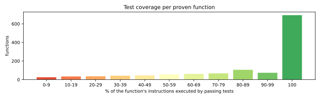

### 7.5 An independent port (`mgsport`)
- A separate project compiled this decompiled C to WebAssembly and then to native Android, and
  runs the original game.
- It found **2 defects** in functions the tests could not fully exercise. Both are fixed here at
  the source, plus one more in the same chain.
- Its exactness was measured:
  - `random()`: 18,000 / 18,000 values identical to the real iOS library;
  - Android's `sinf`/`cosf`/`atan2f` differ by 1 ULP on about 16 % of the game's inputs;
  - the missing flush-to-zero emulation changes 8 functions on real states.

  See `docs/PORT_REVIEW.md`.

---

## 8. Every defect class found

Each was a real difference between "decompiled" and "identical" that compiled silently.

| # | defect class | how it was found | fix |
|---|---|---|---|
| 1 | Thumb decoded as ARM | static: mode lives in `n_desc` | seed modes before analysis |
| 2 | double maths narrowed to float | differential test | decompiler patch |
| 3 | float `+`/`*` reassociated | differential test | decompiler patch |
| 4 | bit reinterpretation printed as conversion | differential test | `__BITCAST` in the exporter |
| 5 | int compare of float-typed operands | differential test | compare bits |
| 6 | VFP register spill helper clobbered arguments | V0 audit | call-fixup `sp -= 64` |
| 7 | integer division by zero traps / differs | measured on the oracle | helpers with device semantics |
| 8 | variadic calls lost their arguments | differential test | format-string-typed sites |
| 9 | inferred return types | call-site analysis | binary-proven `void` |
| 10 | constant printed as a function name | differential test | exact literal |
| 11 | stack buffer read after a later call overwrote it (stret) | differential test, then a static check over all functions | `stret_dead.tsv` |
| 12 | untyped call with a phi selector (floats promoted) | natural shop states | site prototype table |
| 13 | distinct strings collided in C names | callee-boundary test | address-unique names |
| 14 | 64-bit method arguments in the wrong storage (NSTimer) | callee-boundary test | two APCS words |
| 15 | `return x;` deleted by a recompile transform | Survival tests | keyword-safe pattern |
| 16 | C++ class size from `this` accesses only (`Sound` 0x39 vs 0x3c) | **the Android port** | allocation-size table |
| 17 | float bits returned as `undefined4`, then converted | **the Android port** | float-return table |
| 18 | ledger let a pass outrank a real return difference | re-test after 17 | stricter ranking |

---

## 9. Timeline

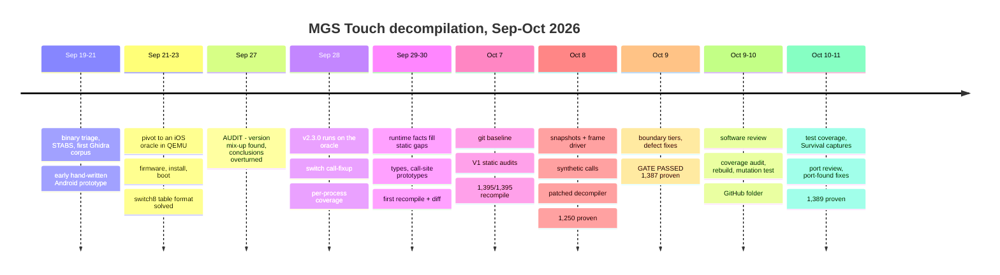

---

## 10. Lessons

- **Run static and dynamic analysis together.** Static analysis alone produced plausible C with
  silent float, calling-convention and switch errors. Dynamic analysis alone would never have
  reached most code. Each made the other trustworthy.
- **Test against the original machine code, from real states, bit for bit.** Visual or behavioural
  similarity hides almost every defect in the table above.
- **Link the recompiled function against the original binary**, so a failure points at exactly
  one function.
- **Version and fingerprint everything**, so results go stale automatically when the code
  changes.
- **Check the checker:** coverage of the decompiler's real flow, a from-scratch rebuild, mutation
  testing, test coverage, and an independent consumer (the port). Each found something the
  previous ones missed.
- **Write down corrections.** Several conclusions were wrong and retracted in the journal: the
  version mix-up, a blamed SjLj approximation, a mis-identified app. The record of *why* matters
  as much as the result.

---

## 11. Limits and what is next

- **"Proven" covers the paths the tests executed: 47.9 % of instructions.** Unexercised paths
  are decompiled and compile but are unchecked. The best way to close the gap is a port compared
  frame by frame with the original running in the emulator.
- **Six V0 functions** (crt0 entry, `_main`, dyld glue, three switch helpers) are verified by
  reading the assembly; they cannot be tested in isolation.
- **Platform exactness** (iOS libm, flush-to-zero, Helvetica text, IMA4 and OpenAL details) is a
  port concern. It is measured in `docs/PORT_REVIEW.md` and `docs/PLATFORM_API.md`.

---

## 12. Where things are

| | |
|---|---|
| step-by-step reproduction | [`../README.md`](../README.md) |
| every tool, one line each | [`TOOLS.md`](TOOLS.md) |
| sign-off, audits, coverage, rebuild, mutation, port review | [`../docs/`](../docs/) |
| per-function ledger | `../analysis/verification/function_status.tsv`, `test_coverage.tsv` |
| figures (regenerate) | `python3 tools/make_claude_notes.py` |
