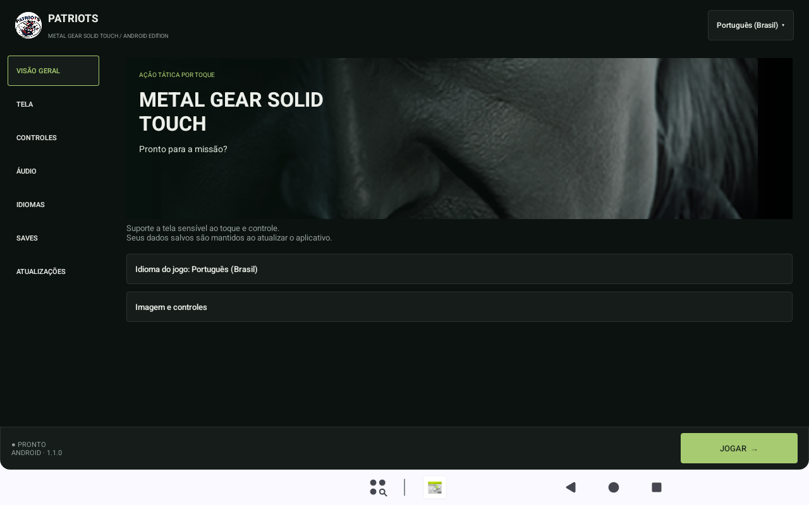
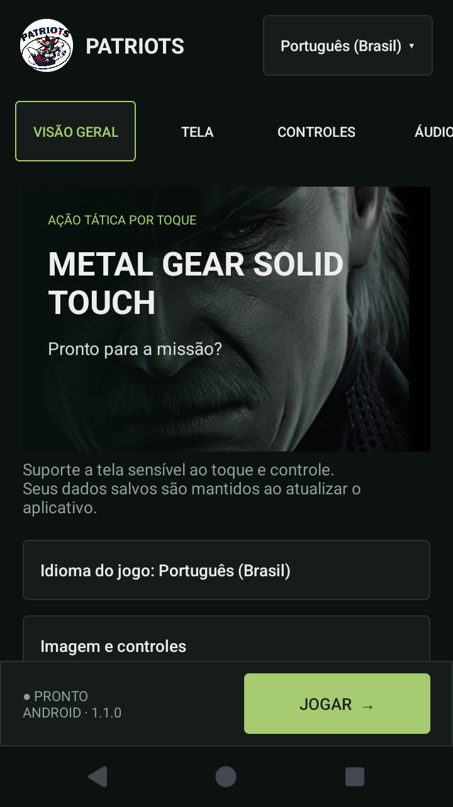

# Android launcher and tablet layout

Android 1.1.0 uses the corresponding PC launcher artwork and palette with Android-native controls. Touch has a dark sidebar on wide windows; Mobile has a light header/tab bar. Phones use scrollable tabs, and PLAY stays outside the page scroll area. Display/audio/touch settings, three languages, translator credit, export backup and update checks have separate pages.

## Verification scope

Android 15/API 35 x86_64 emulator: 1280×800/160 dpi landscape tablet, 800×1280/160 dpi portrait tablet, 720×1280/320 dpi phone and 600×800/160 dpi narrow window with font scale 1.3. All keep the Play footer accessible. The narrow-window check is a size simulation, not a claim of testing every OEM split-screen mode. Physical phones/tablets and a complete game playthrough remain untested.

APK signing identity, three native ABIs, 16 KB ZIP/native LOAD alignment and save-preserving replacement are checked separately from layout. ARM binaries are compiled, not performance-tested on physical ARM hardware. Install an update over the existing application; do not uninstall it to update.

Touch keeps original portrait menu aspect ratios and fits landscape scenes upright without stretching. Mobile gameplay remains landscape with its existing resolution settings. The old screenshot's system portrait letterbox is removed from the launchers.
