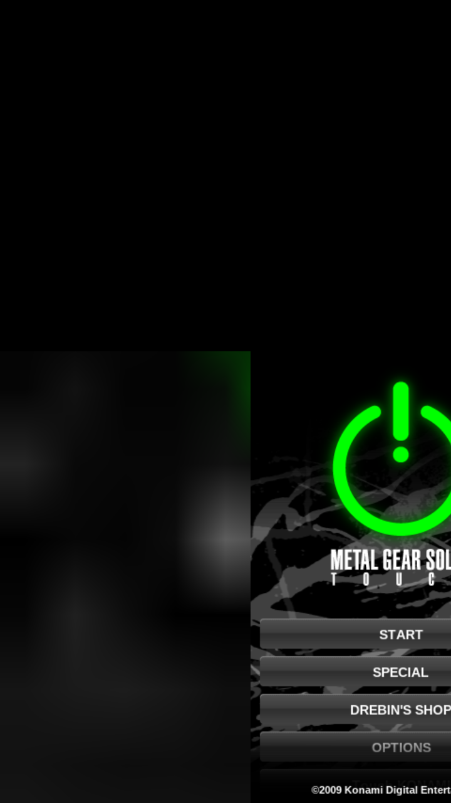
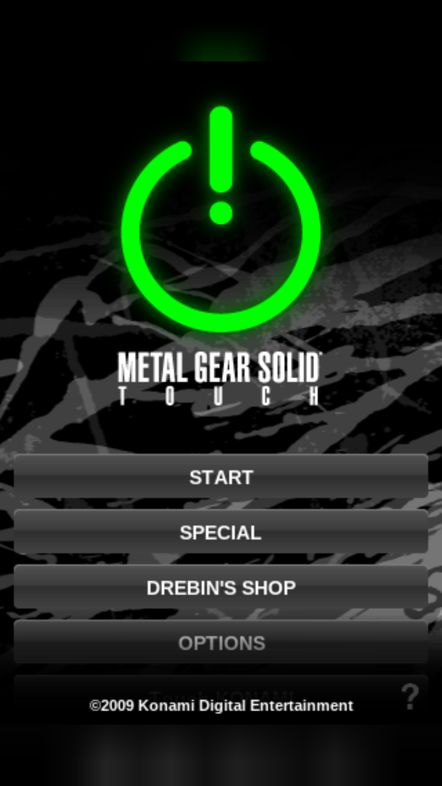

# Android rotation recovery · 1.1.1

The 1.1.0 bug is reproducible without restarting the game: turn the native title screen sideways, then upright. The picture is clipped on the first turn and stays displaced on return. Rotation callbacks could query EGL before the resized buffers became current; those stale dimensions were retained for the rest of the session.

1.1.1 queries the live drawable during presentation and again after swapping, where EGL drivers can acknowledge pending size changes. Redraw callbacks repaint the current image at the acknowledged size. Scene axes are kept separate from the Android window shape, so a landscape scene remains upright even inside a portrait window.

The GL context/resources survive a destroyed window using a parking pbuffer; ordinary game rendering keeps the existing window/FBO path. On the no-FBO path, a clean retained game canvas is restored before updates and copied only for a fresh game frame. Repainting a paused frame cannot copy the already rotated/composited screen back into itself. Small windows scale this fallback canvas to fit.

Rotation, surface loss and focus loss cancel game/overlay pointers, cursor presses, gyro offsets and held trigger state. An overlay cannot swallow cancellation of a finger already owned by the game. Controller cursor axes use the same presentation transform in gameplay and pause/options. Physical display-mode dimensions determine natural sensor axes without racing logical size/rotation queries.

## Validation

- Android 15 x86_64 emulator, GLES1 translator. The old release visibly fails the same OS rotation scenario.
- Ten OS rotations through 0/90/180/270 degrees in each of the ordinary FBO and forced legacy-copy paths. Normalized menu-image comparisons remain within the animation tolerance and the native process ID stays unchanged.
- Mission 1: pause, rotate upright/sideways repeatedly, compare the frozen scene, resume by touch, rotate while aiming and aim/pause again. Both rendering paths are exercised.
- C regression tests cover scene/pause orientation invariance, pointer round trips and cancellation while an overlay owns input. The device regression script captures real rotations; it does not merely relaunch at different window sizes.
- Three ABIs are built, with APK signature and 16 KB ZIP/native LOAD alignment checks. Personal saves are kept outside the update payload.

Physical phones/tablets, every OEM window manager and a complete playthrough remain untested. Windows and MGS Mobile binaries are unchanged by this Android Touch fix.

## Reproduce on a test installation

Open the native title screen, then run `python android-patriots/tests/rotation_device_test.py --serial emulator-5554 --out rotation-qa`. For a stationary paused landscape scene, add `--scene landscape`. The script uses an explicit device serial, checks the foreground activity/process, compares image bounds/content and restores the original rotation mode. It does not change saves.

For the legacy renderer regression on an emulator, set `adb -s emulator-5554 shell setprop debug.patriots.touch_renderer copy` before starting the game. Restore it to `default` afterwards. This is an opt-in developer override, not a required player setting.

## Captured recovery

Before (1.1.0):

After:

